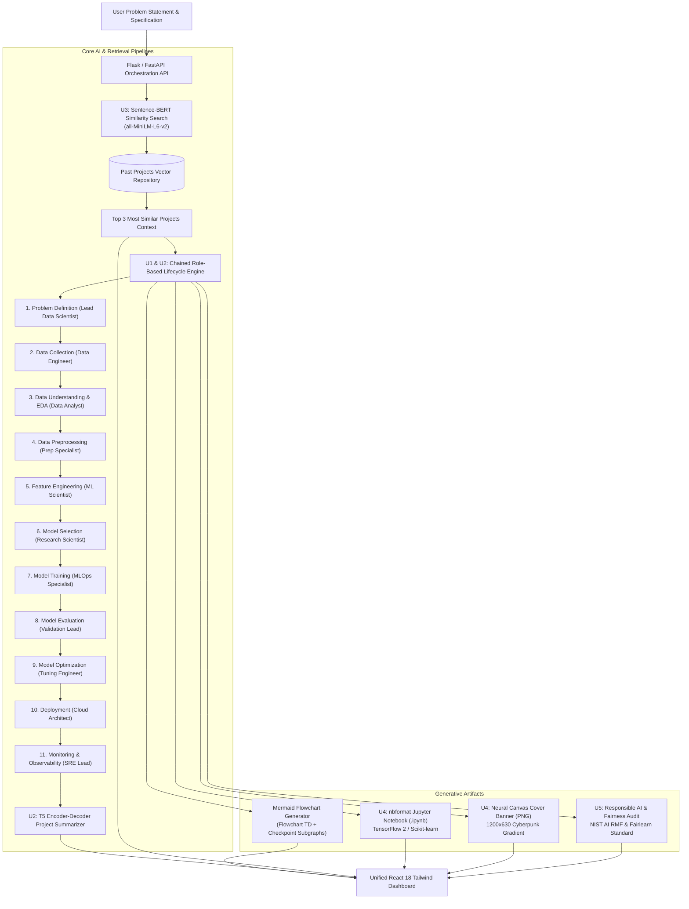

# ML/DL Lifecycle Planner ⚡
### AI-Powered Machine Learning and Deep Learning Project Planning System

A comprehensive, production-grade web application that converts any user problem statement into an exhaustive, stage-wise Machine Learning or Deep Learning engineering roadmap. Powered by **chained role-based AI prompts**, **Sentence-BERT semantic similarity retrieval**, **T5 encoder-decoder summarization**, **Mermaid.js workflow topologies**, **TensorFlow 2 / Scikit-learn starter Jupyter Notebook generators**, and **Responsible AI privacy/bias auditing**.

---

## 🌟 Key Features & Requirements Matrix (U1 – U5)

| Requirement | Module | Description | Implementation Status |
| :--- | :--- | :--- | :--- |
| **U1: Role-Based Lifecycle Prompts** | `lifecycle_engine.py` | 11 canonical lifecycle stages evaluated from specialized industry personas (Lead Data Scientist, Data Engineer, MLOps, Observability Lead, etc.). Outputs activities, tools, I/O, challenges, and governance checkpoints. | ✅ Complete |
| **U2: Chained Prompts + T5 Summarization** | `lifecycle_engine.py`<br/>`t5_summarizer.py` | Sequential context propagation where each stage builds on prior stage outputs. Summarized via T5 encoder-decoder into executive takeaways and architectural blueprints. | ✅ Complete |
| **U3: Sentence-BERT Retrieval** | `sbert_retriever.py`<br/>`past_projects.py` | Semantic similarity search against a curated repository of 10 real-world ML/DL projects using S-BERT embeddings and cosine distance. Retrieved projects serve as prompt context. | ✅ Complete |
| **U4: TF2 Notebook + Cover Banner** | `notebook_generator.py`<br/>`cover_generator.py` | Automated generator for runnable 11-section `.ipynb` notebooks (TensorFlow 2 for DL, Scikit-learn for ML) with synthetic data, and PIL-synthesized 1200x630 AI project cover banners. | ✅ Complete |
| **U5: Privacy & Bias Checkpoints** | `responsible_ai.py` | Comprehensive Responsible AI auditing spanning PII detection, k-anonymity, AES-256 storage, RBAC, class imbalance, demographic representation, and Fairlearn Disparate Impact (DIR). | ✅ Complete |

---

## 🏛️ System Architecture



---

## 📋 The 11 Lifecycle Stages & Specialized Roles

1. **Problem Definition** — *Lead Data Scientist & Product AI Strategist*
   - Translates business objectives into mathematical formulation, loss functions, and SLA performance targets.
   - *Privacy Checkpoint:* PII scope classification and GDPR Article 6 basis.
   - *Fairness Checkpoint:* Demographic and subgroup parity formulation.

2. **Data Collection** — *Data Acquisition & Pipeline Engineer*
   - Ingestion schemas, data versioning with DVC, automated validation, and provenance tracking.
   - *Privacy Checkpoint:* Explicit user consent receipts and AES-256 cloud storage encryption.
   - *Fairness Checkpoint:* Stratified sampling across geographical and demographic cohorts.

3. **Data Understanding & Exploration (EDA)** — *Senior Data Analyst & EDA Specialist*
   - Descriptive statistics, correlation heatmaps, target class imbalance ratios, and anomaly detection.
   - *Privacy Checkpoint:* K-anonymity (k >= 5) in exploratory plots and visual reports.
   - *Fairness Checkpoint:* Audit representation skewness and intersectional cohort distributions.

4. **Data Preprocessing** — *ML Data Preparation Specialist*
   - Leakage-free train/val/test splits, MICE iterative imputation, RobustScaler, and categorical encoding.
   - *Privacy Checkpoint:* Differential privacy noise and quasi-identifier generalization.
   - *Fairness Checkpoint:* Multi-label stratified k-fold balancing sensitive attributes.

5. **Feature Engineering** — *Applied ML Feature Scientist*
   - Domain-specific temporal/interaction transforms, mutual information selection, and VIF filtering.
   - *Privacy Checkpoint:* Proxy variable audit (preventing zip code from reconstructing protected attributes).
   - *Fairness Checkpoint:* Representation parity and adversarial debiasing.

6. **Model Selection** — *Principal ML Research Scientist*
   - Architectural search: Deep Neural Networks (1D-CNN / MLP / ResNet) vs. Ensembles (Random Forest / XGBoost).
   - *Privacy Checkpoint:* Vulnerability analysis against membership inference attacks.
   - *Fairness Checkpoint:* Algorithmic fairness-aware loss function integration.

7. **Model Training** — *MLOps & Training Engineer*
   - TensorFlow 2 Keras `model.fit` or Scikit-learn fitting with Adam, CosineDecay, EarlyStopping, and MLflow logging.
   - *Privacy Checkpoint:* Ephemeral checkpointing with zero raw sample caching.
   - *Fairness Checkpoint:* Equalized loss convergence monitoring across demographic slices.

8. **Model Evaluation** — *Validation & Benchmarking Specialist*
   - Multi-metric holdout evaluation (Precision, Recall, F1, ROC-AUC), Confusion Matrix, and TreeSHAP explainability.
   - *Privacy Checkpoint:* Logit entropy and model extraction defense.
   - *Fairness Checkpoint:* Fairlearn Disparate Impact Ratio (DIR >= 0.80) and Equalized Odds difference.

9. **Model Optimization** — *Performance & Hyperparameter Tuning Engineer*
   - Bayesian hyperparameter tuning with Optuna, INT8 post-training quantization, and ONNX Runtime compilation.
   - *Privacy Checkpoint:* Cryptographic SHA-256 model artifact signing.
   - *Fairness Checkpoint:* Verification of zero disparate degradation on quantized representations.

10. **Deployment** — *Cloud MLOps & Production Architect*
    - Docker containerization, FastAPI / Triton inference serving, Kubernetes canary routing, and circuit breakers.
    - *Privacy Checkpoint:* TLS 1.3 encryption in transit and ephemeral payload processing.
    - *Fairness Checkpoint:* Production traffic routing neutrality audit.

11. **Monitoring and Maintenance** — *Reliability & Observability Lead*
    - Evidently AI and Prometheus telemetry tracking Wasserstein distance, Population Stability Index (PSI), and drift.
    - *Privacy Checkpoint:* 30-day log scrubbing and GDPR Article 17 Right-to-be-Forgotten compliance.
    - *Fairness Checkpoint:* Continuous rolling 7-day Disparate Impact alarm triggers.

---

## 🧪 Demonstration Projects

The planner includes two pre-configured, production-ready demonstration projects accessible via one-click preset buttons:

### 1. Machine Learning Example: Student Academic Performance Prediction
- **Problem Statement:** Predict student semester grades and dropout risks early to enable proactive counseling interventions.
- **Paradigm:** Traditional Machine Learning with Scikit-learn.
- **Model Architecture:** Balanced Random Forest Classifier & Gradient Boosting.
- **Notebook Output:** 11-section runnable `.ipynb` with synthetic student demographics, study hours, attendance rates, and feature importance bar charts.

### 2. Deep Learning Example: IoT Network Intrusion & Threat Detection (NIDS)
- **Problem Statement:** Real-time deep learning detection of zero-day exploits, port scans, and DDoS traffic in IoT connected networks.
- **Paradigm:** Deep Learning with TensorFlow 2.
- **Model Architecture:** 4-layer Keras Sequential Deep Neural Network with BatchNormalization, Dropout, and He-Normal initialization.
- **Notebook Output:** 11-section runnable `.ipynb` with synthetic 78-feature network flow statistics, training loss convergence curves, and ROC plots.

---

## 🚀 Installation & Quick Start

### Prerequisites
- Python 3.10+ (Recommended Python 3.12)
- Node.js v18+ and npm

### 1. Clone & Setup Backend
```bash
cd backend
python3 -m venv venv
source venv/bin/activate
pip install -r requirements.txt
```

### 2. Configure Environment (Optional)
```bash
cp .env.example .env
```
*(The application works completely out-of-the-box using built-in high-accuracy local engines without external API keys).*

### 3. Build & Run Frontend
```bash
cd frontend
npm install
npm run build
```

### 4. Launch Application
```bash
# Start backend (serves both API and compiled React dashboard on port 5050)
PYTHONPATH=backend python3 backend/app.py
```

Open your browser at **`http://127.0.0.1:5050`**.

---

## 📂 Project Directory Structure

```
mldl-lifecycle-planner/
├── backend/
│   ├── app.py                      # Core Flask API & static React server
│   ├── database/
│   │   └── past_projects.py        # 10 curated projects for S-BERT retrieval
│   └── modules/
│       ├── lifecycle_engine.py     # 11 role-based chained stages engine (U1, U2)
│       ├── sbert_retriever.py      # Sentence-BERT semantic similarity engine (U3)
│       ├── t5_summarizer.py        # T5 abstractive summarization engine (U2)
│       ├── mermaid_generator.py    # Mermaid flowchart topology generator (Req 6)
│       ├── notebook_generator.py   # nbformat 11-section notebook generator (U4)
│       ├── cover_generator.py      # PIL neural canvas cover image generator (U4)
│       └── responsible_ai.py       # Responsible AI & fairness auditor (U5)
├── frontend/
│   ├── package.json
│   ├── vite.config.js
│   ├── tailwind.config.js
│   ├── index.html
│   ├── src/
│   │   ├── main.jsx
│   │   ├── index.css
│   │   ├── App.jsx                 # Stateful dashboard orchestrator
│   │   └── components/
│   │       ├── Navbar.jsx
│   │       ├── HeroHeader.jsx
│   │       ├── ProjectInputForm.jsx
│   │       ├── T5SummarySection.jsx
│   │       ├── SimilarProjectsSection.jsx
│   │       ├── MermaidDiagramSection.jsx
│   │       ├── LifecycleStageCards.jsx
│   │       ├── NotebookDownloadSection.jsx
│   │       ├── CoverImageSection.jsx
│   │       ├── ResponsibleAIReport.jsx
│   │       └── Footer.jsx
│   └── dist/                       # Compiled production frontend bundle
├── .env.example                    # Environment variable template
└── README.md                       # Comprehensive technical documentation
```

---

## 🛡️ Responsible AI & Ethical Compliance

The system implements the **Responsible AI by Design** framework adhering to:
- **NIST AI Risk Management Framework (RMF 1.0)**
- **EU Artificial Intelligence Act (High-Risk Classification Standards)**
- **Fairlearn Demographic Parity & 80% Disparate Impact Ratio (DIR)**
- **GDPR Article 22 (Automated Decision-Making Transparency)**

---
*Built with ❤️ by Senior AI/ML & Full-Stack Engineers.*
