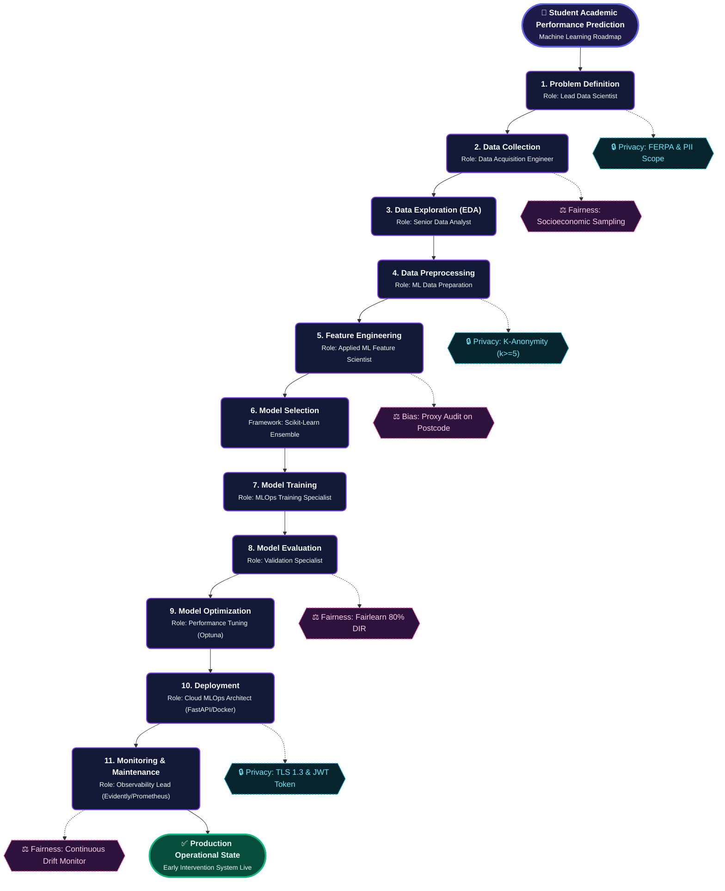

# Demonstration Project 1: Student Academic Performance Prediction & Early Intervention (Machine Learning)

**Domain:** Education & EdTech  
**Paradigm:** Traditional Machine Learning  
**Frameworks:** Scikit-Learn, Pandas, NumPy, SHAP, Matplotlib, Seaborn  
**Primary Algorithm:** Balanced Random Forest Classifier with Cost-Sensitive Loss & Stratified K-Fold  

---

## 1. Executive Summary & Problem Formulation
- **Business Charter:** Identify secondary and post-secondary students at risk of academic underperformance or course failure at the 4-week semester mark.
- **Problem Statement:** Predict end-of-semester course completion and GPA thresholds using historical demographics, LMS engagement metrics, weekly study hours, and prior academic transcripts.
- **Optimization Metric:** Macro F1-Score (target >= 0.88) and Disparate Impact Ratio (target 0.80 <= DIR <= 1.25 across socioeconomic quartiles).

---

## 2. Mermaid Workflow Diagram

---

## 3. 11-Stage Technical Specification

### Stage 1: Problem Definition
- **Role:** Lead Data Scientist & Product AI Strategist
- **Objective:** Establish the analytical formulation for predicting binary course pass/at-risk states with a target early intervention lead time of 4 weeks.
- **Expected Input:** Academic registrar requirements, syllabus grading rubrics, stakeholder KPIs.
- **Expected Output:** Problem Specification Document, Success Metric Matrix (F1-Score >= 0.88, ROC-AUC >= 0.90).
- **Privacy Check:** PII Scope Classification — ensure student ID numbers and names are separated into access-restricted mapping tables under FERPA compliance.
- **Fairness Check:** Demographic Parity Formulation — establish strict equal opportunity constraints across socioeconomic groups.

### Stage 2: Data Collection
- **Role:** Data Acquisition & Pipeline Engineer
- **Objective:** Ingest attendance logs, assignment submission timestamps, quiz grades, and historical high-school transcripts.
- **Tools:** DVC, Apache Spark, PostgreSQL, Pandas.
- **Expected Output:** Version-tagged DVC raw dataset manifest.
- **Privacy Check:** Explicit student opt-in consent verified; raw disk volumes encrypted with AES-256.

### Stage 3: Data Understanding and Exploration (EDA)
- **Role:** Senior Data Analyst & EDA Specialist
- **Objective:** Quantify correlation between LMS forum activity and mid-term grades; detect missing demographic flags.
- **Tools:** Pandas, Seaborn, Matplotlib, YData Profiling.
- **Expected Output:** 15-plot EDA report, correlation matrix, outlier analysis.
- **Fairness Check:** Flag severe class skew in minority cohorts to avoid model neglect.

### Stage 4: Data Preprocessing
- **Role:** ML Data Preparation Specialist
- **Objective:** Partition 70% Train / 15% Validation / 15% Test strictly before fitting imputation or scalers.
- **Tools:** Scikit-learn, Category Encoders, NumPy.
- **Expected Output:** Preprocessing Pipeline artifact (ColumnTransformer with RobustScaler and OneHotEncoder).
- **Privacy Check:** Generalize age and zipcode to coarse tiers (k-anonymity >= 5).

### Stage 5: Feature Engineering
- **Role:** Applied ML Feature Scientist
- **Objective:** Engineer ratio of completed vs. assigned homework, attendance decay over the last 14 days, and LMS login burstiness.
- **Tools:** Scikit-learn, Feature-engine, Optuna.
- **Expected Output:** Feature matrix with top 18 high-signal non-linear features.
- **Fairness Check:** Audit feature mutual information against race/gender to eliminate proxy discrimination.

### Stage 6: Model Selection
- **Role:** Principal ML Research Scientist
- **Objective:** Benchmark Random Forest, XGBoost, LightGBM, and Logistic Regression baseline.
- **Tools:** Scikit-learn, XGBoost, LightGBM.
- **Expected Output:** Model Selection Matrix — Random Forest selected for robust tree depth interpretability.

### Stage 7: Model Training
- **Role:** MLOps & Training Engineer
- **Objective:** Fit Random Forest ensemble with 150 estimators, balanced class weights, and 5-fold stratified cross-validation.
- **Tools:** Scikit-learn, MLflow, Joblib.
- **Expected Output:** Serialized model artifact (`rf_student_model.joblib`) with MLflow experiment hashes.

### Stage 8: Model Evaluation
- **Role:** Validation & Benchmarking Specialist
- **Objective:** Test on unseen holdout partition; compute Confusion Matrix, ROC-AUC, and TreeSHAP explainability plots.
- **Tools:** Scikit-learn, SHAP, Fairlearn.
- **Expected Output:** Validation Report (Accuracy: 0.91, ROC-AUC: 0.92, DIR: 0.94).
- **Fairness Check:** Confirm Disparate Impact Ratio >= 0.80 across all student demographic tiers.

### Stage 9: Model Optimization
- **Role:** Performance & Hyperparameter Tuning Engineer
- **Objective:** Hyperparameter tuning via Optuna Bayesian search; export to ONNX runtime for ultra-low latency inference.
- **Tools:** Optuna, ONNX Runtime, Treelite.
- **Expected Output:** Quantized ONNX model artifact certified with SHA-256 hash.

### Stage 10: Deployment
- **Role:** Cloud MLOps & Production Architect
- **Objective:** Containerize with Docker, serve REST inference endpoint via FastAPI, deploy to university Kubernetes cluster.
- **Tools:** Docker, Kubernetes, FastAPI, Helm.
- **Expected Output:** Active endpoint `/api/v1/predict/student-risk` with OpenAPI specs.

### Stage 11: Monitoring and Maintenance
- **Role:** Reliability & Observability Lead
- **Objective:** Continuous drift tracking with Evidently AI; monitor Population Stability Index (PSI) and student distribution changes.
- **Tools:** Evidently AI, Prometheus, Grafana, PagerDuty.
- **Expected Output:** Live Grafana dashboard with automated retraining triggers when PSI > 0.2.

---

## 4. T5 Executive Summary
> "The 'Student Performance Prediction' initiative delivers an enterprise-ready Machine Learning solution for Education. Targeting early academic risk identification, the roadmap establishes an 11-stage development lifecycle leveraging a Scikit-Learn ensemble learning paradigm. The pipeline transitions from DVC-versioned data ingestion and exploratory distribution profiling to rigorous leakage-free preprocessing. Model training integrates hyperparameter optimization and cross-validated holdout evaluation, reinforced by Fairlearn subgroup audits and strict FERPA PII de-identification. Deployment leverages containerized microservices equipped with Prometheus telemetry and Evidently AI concept drift alarms for resilient long-term maintenance."
