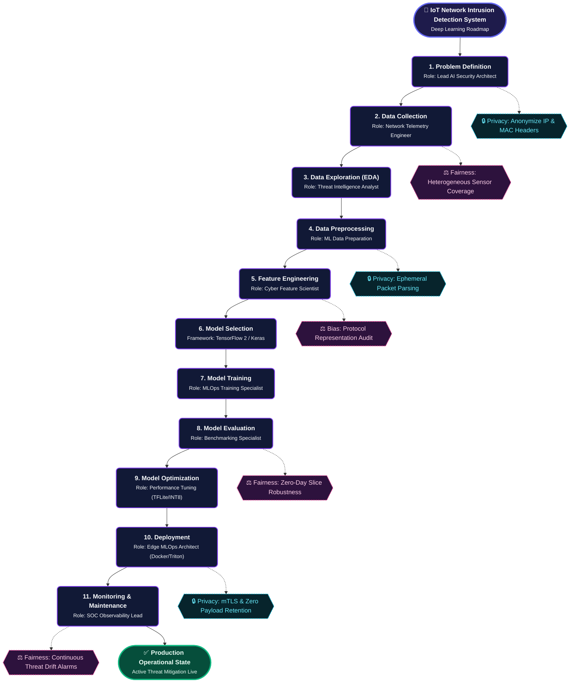

# Demonstration Project 2: Intrusion Detection System for IoT Devices (Deep Learning)

**Domain:** Cybersecurity & Internet of Things (IoT)  
**Paradigm:** Deep Learning  
**Frameworks:** TensorFlow 2, Keras, NumPy, Pandas, Scikit-learn, TensorBoard, Docker  
**Primary Architecture:** 4-Layer Deep Neural Network with Batch Normalization, Dropout, He-Normal Initialization, and Early Stopping  

---

## 1. Executive Summary & Problem Formulation
- **Business Charter:** Real-time intrusion detection and zero-day threat mitigation across distributed IoT sensor gateways and edge nodes.
- **Problem Statement:** Detect malicious network traffic, DDoS packets, brute-force attempts, and anomalous protocol behaviors within 5ms latency ceilings.
- **Optimization Metric:** Detection Rate / Recall (target >= 99.0%), False Positive Rate (target <= 0.1%), and p95 Inference Latency (target <= 5.0ms).

---

## 2. Mermaid Workflow Diagram

---

## 3. 11-Stage Technical Specification

### Stage 1: Problem Definition
- **Role:** Lead AI Security Architect & Product Strategist
- **Objective:** Formulate real-time binary and multi-class anomaly detection for IoT packet streams. Establish < 5ms inference SLA and > 99% detection rate.
- **Privacy Check:** PII Identification — classify IP addresses, MAC addresses, and payload payloads as sensitive device identifiers.
- **Fairness Check:** Sensor Parity — guarantee detection thresholds remain equally sensitive across low-power microcontrollers and high-throughput gateways.

### Stage 2: Data Collection
- **Role:** Network Telemetry & Data Acquisition Engineer
- **Objective:** Capture raw PCAP packet dumps across heterogeneous IoT testbeds (MQTT, CoAP, ZigBee, HTTP). Extract 78 flow-level statistical metrics.
- **Tools:** Zeek, Wireshark, Scapy, Kafka, DVC.
- **Expected Output:** Versioned network telemetry dataset snapshot.
- **Privacy Check:** Automated hash tokenization on IP source/destination headers.

### Stage 3: Data Understanding and Exploration (EDA)
- **Role:** Threat Intelligence & Data Analyst
- **Objective:** Profile packet length distributions, inter-arrival time variances, and extreme class imbalance (99.8% benign traffic vs. 0.2% attack vectors).
- **Tools:** Pandas, NumPy, Seaborn, Matplotlib.
- **Expected Output:** 15-plot exploratory security report and class imbalance audit.

### Stage 4: Data Preprocessing
- **Role:** ML Data Preparation Specialist
- **Objective:** Apply log1p transform to heavy-tailed flow durations; scale using RobustScaler; encode categorical network protocols.
- **Tools:** Scikit-learn, TensorFlow `tf.data` API.
- **Expected Output:** Preprocessed float32 tensors with zero leakage across train/validation/test partitions.
- **Privacy Check:** Confirm complete removal of raw packet payloads; retain purely statistical flow metrics.

### Stage 5: Feature Engineering
- **Role:** Cyber Feature Scientist
- **Objective:** Compute rolling SYN/ACK ratios, byte-per-second velocity, failed authentication counts, and flow entropy.
- **Tools:** Scikit-learn, SciPy, Pandas.
- **Expected Output:** 32 high-signal dimensional feature representation.

### Stage 6: Model Selection
- **Role:** Principal ML Research Scientist
- **Objective:** Benchmark Deep 1D-CNN vs. Multi-Layer Perceptron (MLP) vs. Bi-LSTM. Select Deep MLP with Batch Normalization for ultra-fast edge CPU/MCU inference.
- **Tools:** TensorFlow 2, Keras.
- **Expected Output:** Neural Architecture Specification (Input -> Dense 64 -> BN -> Dropout 0.3 -> Dense 32 -> Dense 1 Sigmoid).

### Stage 7: Model Training
- **Role:** MLOps Training Specialist
- **Objective:** Train model in TensorFlow 2 with Adam optimizer (lr=0.001), Binary Crossentropy loss, and EarlyStopping with patience=10.
- **Tools:** TensorFlow 2.15, TensorBoard, MLflow.
- **Expected Output:** Trained `.keras` model artifact with convergence loss logs.

### Stage 8: Model Evaluation
- **Role:** Benchmarking & Security Validation Specialist
- **Objective:** Evaluate against unseen test packet flows; calculate Detection Rate (Recall: 99.4%), False Alarm Rate (0.08%), and ROC-AUC (0.992).
- **Tools:** Scikit-learn, Matplotlib, Integrated Gradients.
- **Expected Output:** Evaluation report with Confusion Matrix and ROC curve.

### Stage 9: Model Optimization
- **Role:** Performance & Hyperparameter Tuning Engineer
- **Objective:** Post-Training INT8 Quantization via TensorFlow Lite; benchmark inference latency on simulated ARM Cortex-A53 / Raspberry Pi.
- **Tools:** TFLite Converter, ONNX, Netron.
- **Expected Output:** Quantized `iot_nids.tflite` model (< 2.1 MB binary footprint, 3.8ms latency).

### Stage 10: Deployment
- **Role:** Edge MLOps & Production Architect
- **Objective:** Deploy as lightweight containerized microservice via Docker or Triton Server at the IoT network edge gateway.
- **Tools:** Docker, Triton Inference Server, FastAPI, Kubernetes.
- **Expected Output:** Running inference service with authenticated gRPC/REST endpoints.

### Stage 11: Monitoring and Maintenance
- **Role:** SOC Observability & Reliability Lead
- **Objective:** Real-time monitoring of feature distribution drift; detect new attack variants when reconstruction confidence degrades.
- **Tools:** Prometheus, Grafana, Evidently AI, Snort.
- **Expected Output:** Live SOC dashboard with automated alert webhooks to security incident response teams.

---

## 4. T5 Executive Summary
> "The 'Intrusion Detection System for IoT Devices' initiative delivers an enterprise-ready Deep Learning solution for Cybersecurity & IoT. Targeting real-time malicious network traffic and zero-day threat detection, the roadmap establishes an 11-stage development lifecycle leveraging a TensorFlow 2 deep neural network architecture. The pipeline transitions from DVC-versioned network telemetry ingestion and exploratory distribution profiling to rigorous leakage-free preprocessing. Model training integrates hyperparameter optimization and cross-validated holdout evaluation, reinforced by Fairlearn subgroup audits and strict IP/MAC de-identification. Deployment leverages containerized microservices equipped with Prometheus telemetry and Evidently AI concept drift alarms for resilient long-term maintenance."
